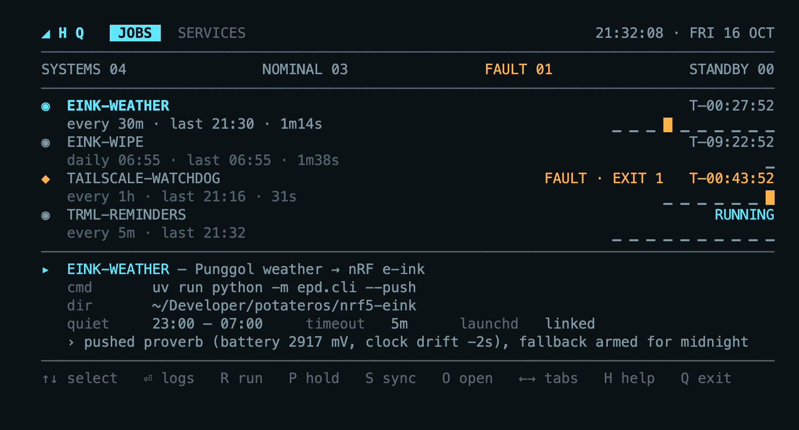
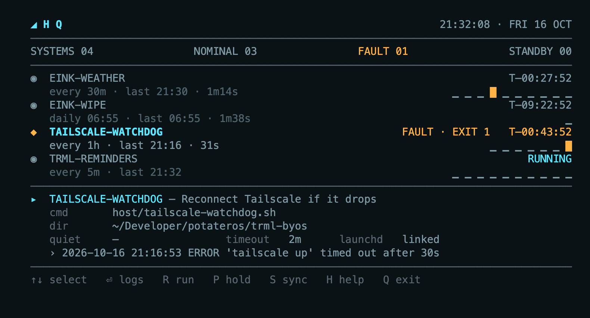
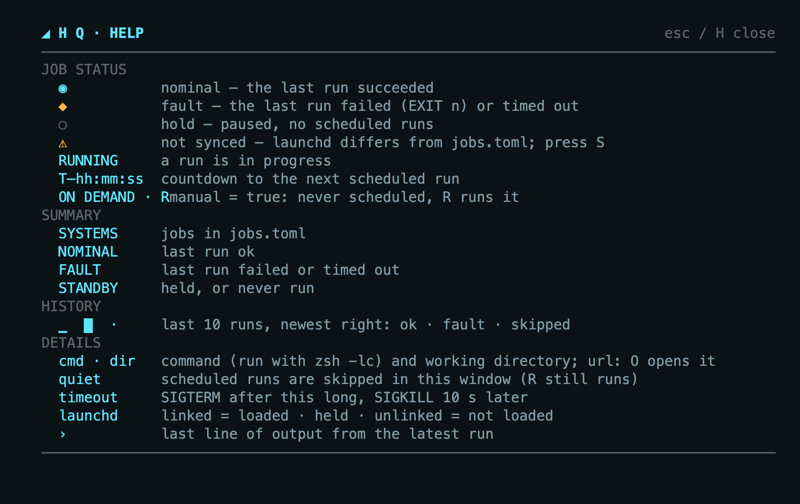
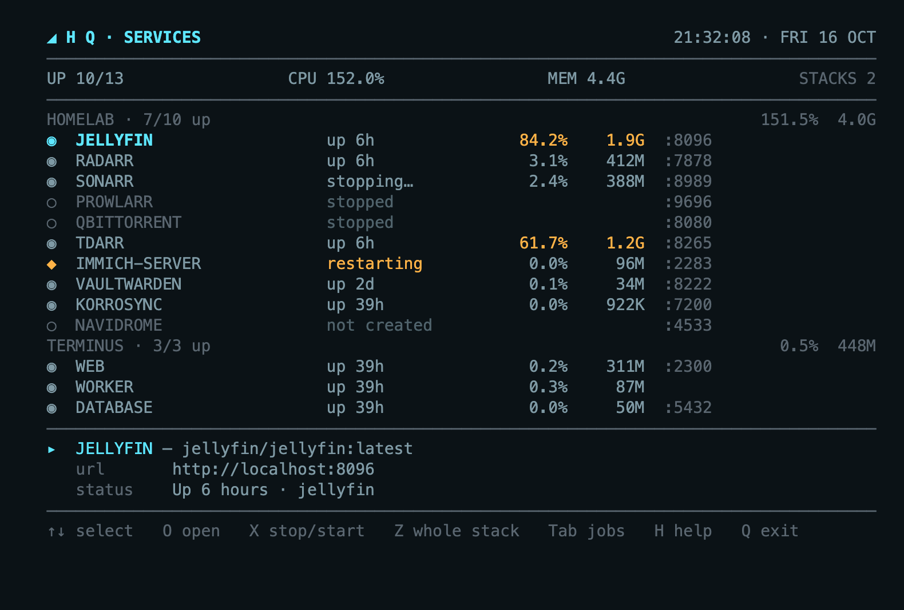
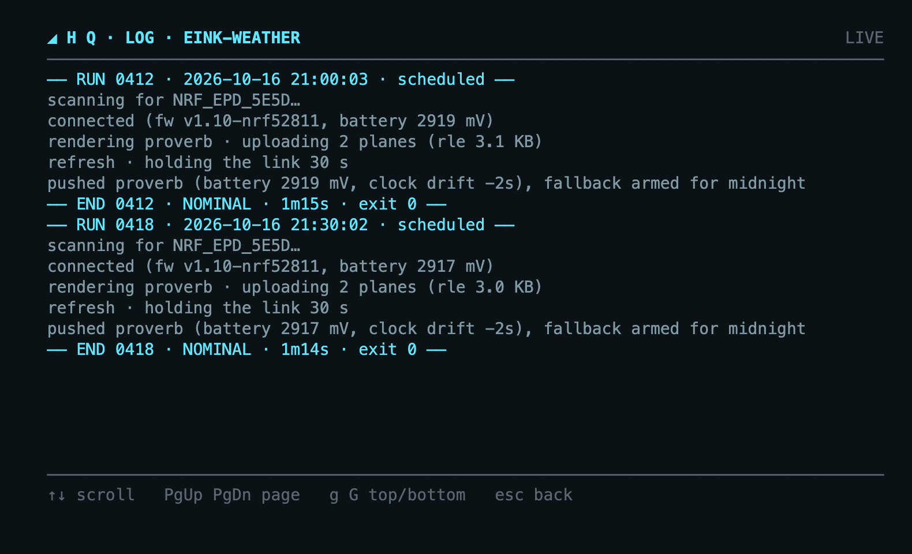

# cron-hq
A terminal command centre for the small scheduled jobs on one Mac. You list the jobs in one file, and `hq` turns them into launchd agents. Every run gets the same treatment: quiet hours, holds, overlap locks, timeouts, logs and history. You can watch it all from a dashboard in the terminal.



Each job's code stays in its own project. hq only knows the folder to run in and the command to run.

## Contents

- [Features](#features)
- [Install](#install)
- [Adding a job](#adding-a-job)
- [jobs.toml reference](#jobstoml-reference)
- [Commands](#commands)
- [The dashboard](#the-dashboard)
- [How it works](#how-it-works)
- [Files and data](#files-and-data)
- [macOS permissions](#macos-permissions)
- [Migrating existing LaunchAgents and uninstalling](#migrating-existing-launchagents-and-uninstalling)
- [Claude Code skill](#claude-code-skill)
- [Troubleshooting](#troubleshooting)
- [Performance](#performance)
- [Development](#development)

## Features

- **One registry.** `jobs.toml` is the whole list. `hq sync` makes launchd match it: it adds, changes and removes only hq's own agents.
- **One runner for every job.** It applies:
  - **holds:** pause a job without deleting it;
  - **quiet hours:** a window when scheduled runs are skipped;
  - **an overlap lock:** a run that would overlap the previous one is skipped;
  - **timeouts:** SIGTERM, then SIGKILL, sent to the whole process group.
  A stopped or killed run is still recorded.
- **Per-job logs and SQLite history.** Every run gets a numbered `RUN`/`END` block in the job's log. The runs table keeps 90 days.
- **A live TUI** built with Rust and ratatui. It shows each job's status, a countdown to its next run, its last 10 runs and its latest output. You can open a scrolling log, run a job now, hold or resume it, and sync, all without leaving the dashboard. Press `H` for help on what each symbol means.
- **Fault tolerant.** Each of these shows up as a fault on the dashboard instead of being silently skipped:
  - a broken `jobs.toml`;
  - a missing directory;
  - a command that isn't found;
  - a job killed mid-run;
  - a stray background process that holds the output open.

## Install

You need macOS, a Rust toolchain ([rustup](https://rustup.rs)) and git.

```sh
git clone https://github.com/potateros/homelab-hq.git ~/Developer/potateros/homelab-hq
cd ~/Developer/potateros/homelab-hq
cargo test --locked                                    # all tests run against temp dirs and a fake launchctl
cargo install --path . --root ~/.local --locked --force
export PATH="$HOME/.local/bin:$PATH"                   # add to ~/.zshrc if `~/.local/bin` isn't on PATH yet
hq sync
```

Then edit `jobs.toml` and run `hq sync` again.

> The LaunchAgents run the **installed** binary `~/.local/bin/hq`, not the checkout. After changing the source, run the `cargo install` line again. The binary bakes in this repo's path (for `jobs.toml` and `migrated/`), so if you move the repo, reinstall; until then `hq` prints a "config not found … reinstall" error. The plists embed only the binary path, so a reinstall needs no `hq sync`.

## Adding a job

1. Add a block to `jobs.toml`:

   ```toml
   [jobs.backup-photos]
   description = "Sync photos to the NAS"
   cwd         = "~/Developer/potateros/some-project"
   command     = "./backup.sh"
   every       = "1h"
   timeout     = "10m"
   ```

2. Run `hq sync`, or press `S` then `Y` in the TUI. You'll see `+ backup-photos` and then `synced`.
3. Press `R` on the job, or run `hq run backup-photos --manual`, and check its log.

Changes to `command`, `cwd`, `quiet`, `timeout` and `description` take effect on the next run, because the runner re-reads `jobs.toml` every time. Changes to the schedule, and adding or removing a job, need `hq sync`.

## jobs.toml reference

Each job is a `[jobs.<id>]` table. The id must match `[a-z0-9-]+`, and its LaunchAgent is named `com.chngu.hq.<id>`.

| key | required | format | default / notes |
|---|---|---|---|
| `command` | yes | string | run as `/bin/zsh -lc '<command>'` from `cwd` |
| `every` | one of `every`/`at`/`manual` | `"90s"`, `"30m"`, `"1h"` | at least 60 s; becomes launchd `StartInterval` |
| `at` | one of `every`/`at`/`manual` | `["06:55", "19:30"]` | local time; becomes launchd `StartCalendarInterval` |
| `manual` | one of `every`/`at`/`manual` | `true` | on demand: no LaunchAgent, never scheduled, listed first, shows `ON DEMAND · R`; `R` (or `hq run <job> --manual`) runs it. Good for launchers. No `quiet` |
| `cwd` | no | path, `~` allowed | `$HOME`; must be a directory |
| `quiet` | no | `"23:00-07:00"` | scheduled runs inside it are skipped; can wrap midnight; manual runs still go |
| `timeout` | no | `"5m"` | `10m`; then SIGTERM to the process group, and SIGKILL 10 s later |
| `description` | no | string | shown on the dashboard |
| `url` | no | `"http://localhost:8742/"` | shown in the detail panel; `O` opens it in the browser |

Any other key is an error. A config error stops every job, and each scheduled run records a fault, until you fix it.

### Docker stacks

`[stacks.<name>]` tables list docker compose projects for the TUI's services view (`Tab`). Only the TUI reads them, so a mistake here shows as an error on that stack and never stops a job.

```toml
[stacks.homelab]
dir = "~/Developer/potateros/homelab"          # compose project directory

[stacks.terminus]
dir      = "~/Developer/potateros/trml-byos"
files    = ["terminus/compose.yml", "compose.override.yml"]   # optional; relative to dir
env_file = "terminus/.env"                                     # optional; relative to dir
```

The jobs in this repo:

| job | schedule | what it does |
|---|---|---|
| `eink-tool` | on demand | opens the e-ink web tool (starts it in the background if needed; it stops itself 10 min after its tab closes) |
| `eink-dashboard-1` | every 30m, quiet 23:00–07:00 | pushes the current layout to the nRF52 e-ink tag ([nrf5-eink](https://github.com/potateros/nrf5-eink)) |
| `eink-dashboard-1-midnight` | daily 00:01 | the same push, right after the firmware's midnight calendar redraw, so the dashboard shows overnight |
| `trml-reminders` | every 5m | exports macOS Reminders for the TRMNL screen (trml-byos) |
| `tailscale-watchdog` | every 1h | reconnects Tailscale if it has stopped |

## Commands

```sh
hq                        # open the TUI dashboard
hq status [--json]        # one line per job: OK / FAULT / HOLD / NEVER, last and next run
hq run <job> [--manual]   # run through the runner; --manual ignores hold and quiet hours
hq logs <job> [-f]        # print the job's log; -f follows it
hq hold <job>             # unload the agent and mark the job held
hq resume <job>           # load it again
hq sync [--yes]           # make ~/Library/LaunchAgents match jobs.toml (asks first unless --yes)
hq uninstall              # remove every hq agent and restore the plists in migrated/
hq --version              # print the installed version
```

`hq run` exits with the job's own exit code. It exits with 124 on a timeout, 1 on a config error and 2 for an unknown job.

## The dashboard

| | |
|---|---|
|  |  |

- **Header:** the clock, then four totals across the top. SYSTEMS is the number of jobs, NOMINAL is jobs whose last run succeeded, FAULT is jobs whose last run failed or timed out, and STANDBY is jobs that are held or have never run.
- **Job rows:**
  - **Status symbol:** `◉` nominal, `◆` fault, `○` hold, `⚠` not synced.
  - **Name and right-hand status:** the countdown to the next run (`T–hh:mm:ss`), `RUNNING` while a run is in progress, `FAULT · EXIT n` or `HOLD`.
  - **Second line:** the schedule, when the last run started and how long it took.
  - **History strip** (last 10 runs, newest on the right): `▁` ok, `█` fault, `·` skipped.
- **Detail panel** (for the selected job): command, folder, quiet window, timeout and launchd state, then the latest line of output. It wraps to two lines, ending in `...` if it's longer.

| key | action |
|---|---|
| `↑` `↓` | select a job |
| `⏎` | open its log (below) |
| `R` | run now (manual: ignores hold and quiet hours) and follow the log |
| `P` | hold / resume |
| `S` | show the sync plan; `Y` applies it, any other key cancels |
| `O` | open the job's `url` |
| `Tab` | switch to the services view (below) |
| `H` | help screen |
| `Q` | quit |

When stacks are configured, a `SERVICES` line under the totals shows how many containers are up and their combined CPU and memory.

**Services view** (`Tab`): every service in each stack, including ones that have no container yet, with its state (`◉` running, `○` stopped or not created, `◆` unhealthy, restarting or crashed), live CPU (as % of one core, so it can pass 100%) and memory from `docker stats` (amber over 50% CPU or 1 GiB), and its first published port. Use it to find what is slowing the Mac down and switch it off.

| key | action |
|---|---|
| `↑` `↓` | select a service |
| `O` | open `http://localhost:<port>` |
| `X` | stop the service, or start it (`docker compose up -d <service>`, which also creates it) |
| `Z` | stop or start the whole stack; `Y` confirms |
| `Tab` | back to jobs |



The log view follows the file live, with a `▸` cursor on the newest line. `↑↓` move the cursor (moving up stops following), `PgUp`/`PgDn` page, `g` jumps to the top and `G` back to live. Long lines are cut with `…`: `⏎` (or space) expands the selected line in full and collapses it again, and `w` wraps every line. `esc` goes back.



The TUI uses the full window (it runs on the terminal's alternate screen, so your scrollback is untouched on exit) and the layout is capped at 90 columns wide.

**Mouse:**

- **Click** a job, log line or service to select it. **Click the selected row** to activate it: a job opens its log, a log line expands or collapses, a service opens its URL.
- **Wheel** scrolls the list, or the log (three lines per notch).
- The **footer keys** are clickable, `Tab ▸` switches view, and in a confirm prompt you can click `Y`.
- To select text, hold **Option** while dragging (iTerm, Ghostty and Terminal.app).

## How it works

```
jobs.toml ──hq sync──▶ ~/Library/LaunchAgents/com.chngu.hq.<id>.plist
                                   │  launchd fires on StartInterval / StartCalendarInterval
                                   ▼
                ~/.local/bin/hq run <id>          (the runner)
                 ├─ held?          → skip, record "paused"
                 ├─ in quiet hours → skip, record "quiet"
                 ├─ lock busy?     → skip, record "overlap"
                 ├─ /bin/zsh -lc '<command>'  in its own process group, PATH + user tool dirs
                 │     stdout+stderr ─▶ logs/<id>.log  and a 20-line tail
                 │     timeout / SIGTERM from launchd ─▶ TERM the group, KILL after the grace
                 └─ history.db row: ok | failed | timeout, exit code, tail
                                   ▲
   hq (TUI) / hq status ── reads history.db, logs, state.json and `launchctl print`
```

- **Schedule:** launchd runs the jobs on time. The countdown on the dashboard is an estimate computed from the last start.
- **PATH:** launchd starts jobs with `PATH=/usr/bin:/bin`, and `zsh -lc` doesn't read `~/.zshrc`. So the runner adds `~/.local/bin`, `~/.bun/bin`, `/opt/homebrew/bin` and `/usr/local/bin` to the front of PATH. Anything that only `~/.zshrc` adds still needs an absolute path.
- **Holds:** a held job's agent is unloaded, and the hold is stored in `state.json`, so `hq sync` doesn't load it again.
- **Interrupted runs:** if a runner dies mid-run, the next run of that job marks the old row as failed with "runner died".

## Files and data

| path | contents |
|---|---|
| `jobs.toml` | the registry (in this repo) |
| `~/Library/LaunchAgents/com.chngu.hq.<id>.plist` | generated by `hq sync`; don't edit by hand |
| `~/Library/Application Support/hq/logs/<id>.log` | per-job log; when it passes 1 MB it's moved to `<id>.log.1` before the next run |
| `~/Library/Application Support/hq/logs/_launchd.log` | launchd's own stdout/stderr for the runner, if it crashes before logging |
| `~/Library/Application Support/hq/history.db` | SQLite (WAL) run history, kept for 90 days |
| `~/Library/Application Support/hq/state.json` | held jobs |
| `~/Library/Application Support/hq/locks/<id>.lock` | the overlap lock (the runner's PID) |
| `migrated/` | LaunchAgents that hq replaced (gitignored) |

## macOS permissions

macOS grants privacy permissions (Bluetooth, Reminders, Calendar, Photos and so on) to the **responsible process**. Under launchd that's the `hq` binary, not your terminal. So a job that works in your terminal can fail under hq. For example, the e-ink push fails with:

```
Bluetooth access is denied by the user for the current application
```

**Fix:** add `~/.local/bin/hq` in System Settings → Privacy & Security → *Bluetooth* (or the relevant category) and turn it on. Reinstalling hq can reset the grant.

Another route is to have the job run its protected step through `/usr/bin/osascript`, which the system already trusts. `trml-reminders` does this for Reminders.

## Migrating existing LaunchAgents and uninstalling

To bring an existing LaunchAgent under hq:

1. add the job to `jobs.toml`;
2. `launchctl bootout gui/$(id -u)/<old-label>`;
3. move the old plist into `migrated/`;
4. `hq sync --yes`.

`hq uninstall` removes every `com.chngu.hq.*` agent and copies the plists in `migrated/` back into `~/Library/LaunchAgents`, then loads them.

## Claude Code skill

`skills/hq-add-job/` is a [Claude Code skill](https://docs.claude.com/en/docs/claude-code/skills). It teaches Claude to add, change or remove hq jobs properly:

- checking the `jobs.toml` rules;
- testing the command with launchd's PATH;
- spotting macOS permission needs;
- retiring old agents;
- proving the job runs under launchd.

To install it for every project, symlink it:

```sh
ln -s ~/Developer/potateros/homelab-hq/skills/hq-add-job ~/.claude/skills/hq-add-job
```

## Troubleshooting

| symptom | cause / fix |
|---|---|
| `zsh: command not found: uv` (or similar) in the log | the tool is only on PATH through `~/.zshrc`; use an absolute path or install it into one of the dirs hq adds |
| `Bluetooth access is denied …` | see [macOS permissions](#macos-permissions) |
| `⚠ NOT SYNCED` | the plist is missing or out of date (e.g. after moving `hq` or editing a schedule); press `S` |
| every job shows a fault with `config error` | `jobs.toml` doesn't parse; `hq status` prints the exact key |
| a job is never `RUNNING` but keeps being skipped as `overlap` | another run still holds the lock; check `locks/<id>.lock` and `ps` for that PID |
| nothing at all in the job's log | check `logs/_launchd.log`; the runner itself failed to start |
| `launchctl bootstrap … failed` on sync | a plist with that label is already loaded from somewhere else; `launchctl bootout` it first |

## Performance

Measured against the old Bun/Ink version:

| | Rust | Bun + Ink |
|---|---|---|
| TUI memory (RSS, idle) | 4.9–5.2 MB | 97–135 MB |
| TUI CPU (idle) | 0.03–0.13% | 3.2–8.3% |
| `hq run` (memory) | 4.0 MB | |
| `hq status` | under 10 ms | |
| binary size | 3.9 MB | |

## Development

```sh
cargo test --locked                  # unit, CLI and TUI tests (ratatui TestBackend)
cargo clippy --all-targets --locked -- -D warnings  # must be clean (CI enforces it)
cargo run --example screenshots      # regenerate docs/images/*.png
HQ_HOME=$(mktemp -d) HQ_FAKE_LAUNCHCTL=1 cargo run    # play with the TUI without touching launchd
```

CI (`.github/workflows/ci.yml`) runs clippy, the tests and a release build on macOS for every push to `main`, every pull request and every `v*` tag.

Environment overrides, used by the tests and for dry runs:

| variable | default |
|---|---|
| `HQ_HOME` | `~/Library/Application Support/hq` |
| `HQ_CONFIG` | `<repo>/jobs.toml` |
| `HQ_LAUNCH_AGENTS_DIR` | `~/Library/LaunchAgents` |
| `HQ_MIGRATED_DIR` | `<repo>/migrated` |
| `HQ_FAKE_LAUNCHCTL=1` | use an in-memory launchctl |

Source layout:

| file | role |
|---|---|
| `src/main.rs` | CLI entry point and command dispatch |
| `src/lib.rs` | library root, so `examples/screenshots.rs` and the tests reuse the modules |
| `src/config.rs` | `jobs.toml` parsing and validation (`ConfigError`) |
| `src/schedule.rs` | quiet windows, next-run estimates, countdowns |
| `src/runner.rs` | `hq run`: hold, quiet hours, lock, spawn, timeouts, signals, history |
| `src/history.rs` | SQLite run history (rusqlite) |
| `src/log.rs` | per-job log append, rotation, tail buffer |
| `src/launchd.rs` | plist rendering, sync plan/apply, hold, resume, uninstall |
| `src/snapshot.rs` | everything the dashboard shows, in one read |
| `src/state.rs` | held jobs (`state.json`) |
| `src/stacks.rs` | `[stacks.*]` parsing and docker compose status, stats, start/stop for the services view |
| `src/paths.rs` | every path, and the `HQ_*` overrides |
| `src/tui/mod.rs` | event loop, app state, global keys, mouse dispatch, worker threads |
| `src/tui/jobs.rs` | jobs view: dashboard, job rows, detail panel, sync prompt |
| `src/tui/services.rs` | services view and the start/stop actions |
| `src/tui/logview.rs` | full-screen log view with a line cursor |
| `src/tui/help.rs` | per-view help screen |
| `src/tui/theme.rs` | colours, widths and text helpers |
| `src/tui/canvas.rs` | drawing helpers: width-clipped spans, space-between rows, rules |
| `src/tui/testing.rs` | shared test helpers |
| `examples/screenshots.rs` | renders the docs/images screenshots |
| `vendor/iana-time-zone-stub` | stub that avoids linking CoreFoundation |

Design history: [spec](docs/superpowers/specs/2026-10-16-hq-command-centre-design.md) and [implementation plan](docs/superpowers/plans/2026-10-16-hq-command-centre.md).
